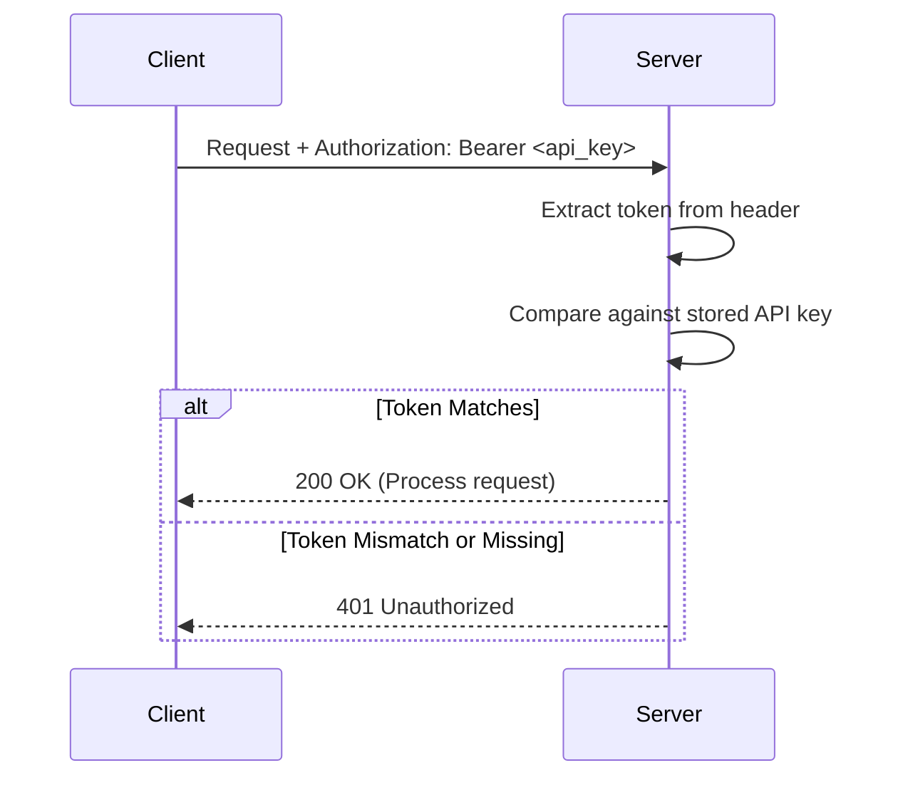

## TL;DR

- **API keys work for local dev and internal tools** where stdio limits exposure and trusted users are the norm
- **Bearer tokens are simple**—anyone who holds the token can use it, like cash
- **Store keys in environment variables**, never in code—use `.env` files locally, secret managers in production
- **Add basic rate limiting** to prevent resource exhaustion even when all users are trusted
- **API keys don't carry user identity**—you can't distinguish User A from User B without custom mapping
- **Know when to level up** - multiuser servers, public deployment, and audit requirements need OAuth

---

## 1. Introduction: The "Good Enough" Starting Point

If you're building an MCP server for local development or an internal tool, you don't need OAuth 2.1, Dynamic Client Registration, or an external identity provider. You need **API keys**—a simple, practical approach that gets you shipping.

This post walks through implementing bearer token authentication for MCP servers. You'll learn when API keys are sufficient, how to secure them, how to add basic rate limiting, and what limitations you'll hit as your project grows.

**Important note on transport scope**: The techniques in this guide apply to servers exposed over HTTP (SSE). If you are using standard stdio, the transport is already isolated to your local machine—your security boundary is process isolation, not HTTP headers. As the FastMCP documentation states:

> "Authentication applies only to FastMCP's HTTP-based transports (`http` and `sse`). The STDIO transport inherits security from its local execution environment." [4]

*(Version note, October 2026: FastMCP is now at 4.x. That transport boundary is unchanged—everything in this post still applies; check [gofastmcp.com](https://gofastmcp.com/servers/auth/authentication) for current API details.)*

The goal: ship a secure MCP server without over-engineering for threats you don't face yet.

---

## 2. When API Keys Are Sufficient

API keys are the right choice for **local development or internal tools**.

**You're in the right scenario if**:

- Your server runs via stdio on the same machine as the client
- Your users are you, or trusted colleagues on the same network
- The consequence of unauthorized access is "restart the server," not "data breach"

**The stdio transport provides inherent boundaries**. A stdio MCP server can only be invoked by processes on the same machine. As the MCP documentation notes: "For MCP servers using the STDIO transport, you can use environment-based credentials... because an STDIO-built MCP server runs locally." [1]

This doesn't mean stdio servers are invulnerable—local process compromise is still possible. But it does mean you're not defending against anonymous internet attackers.

**When to level up**: Your server becomes HTTP-accessible (SSE transport), you need to distinguish between multiple users, you need per-user audit logs, or you're integrating with third-party services that require OAuth.

Think of API keys like a house key—fine for your family, inadequate for an office building.

---

## 3. Simple Bearer Token Implementation

A **bearer token** is exactly what it sounds like: whoever bears (holds) the token can use it. Like cash, possession equals authorization.

The HTTP standard defines bearer token authentication in RFC 6750. Clients include the token in the `Authorization` header:

`Authorization: Bearer sk_live_51AbCdEf...`

**A note on terminology**: We're using the Bearer token scheme (RFC 6750) as the transport format—the `Authorization: Bearer <token>` header structure. However, the payload itself is a static API key rather than a dynamic OAuth token with claims and expiration. This is why our code checks for simple string equality rather than performing JWT validation or introspection.

For MCP servers exposed over SSE, this means extracting the token from incoming HTTP requests and validating it against a known key. Here's a simple implementation in Python using FastMCP:

```python
import os
from fastmcp import FastMCP

API_KEY = os.getenv("MCP_API_KEY", "dev-key-change-me")
mcp = FastMCP("my-server")

def check_auth(request):
    auth_header = request.headers.get("Authorization", "")
    if not auth_header.startswith("Bearer "):
        return False
    token = auth_header.split(" ", 1)[1]
    return token == API_KEY

@mcp.tool
def sensitive_operation(data: str) -> str:
    """An operation that requires authentication."""
    if not check_auth(request):
        raise ValueError("Invalid API key")
    return f"Processed: {data}"
```

**The pattern**: extract the `Authorization` header, verify it starts with `Bearer`, compare the token against your stored key, and reject unauthorized requests.

### Visualizing the Authentication Flow

Here's how the authentication handshake works between client and server:



### Configuring the Client

You know how to lock the door—now here's how to open it. Clients need to send the `Authorization` header with each request. For MCP clients like Claude Desktop, you configure this in your client configuration file.

Here's an example `claude_desktop_config.json` showing how to pass the bearer token:

```json
{
  "mcpServers": {
    "my-secure-server": {
      "command": "npx",
      "args": ["-y", "@mycompany/my-mcp-server"],
      "env": {
        "MCP_API_KEY": "sk_live_your-secret-key-here"
      }
    }
  }
}
```

For HTTP/SSE servers where the client needs to send headers directly, the configuration will depend on your MCP client's implementation. The key principle: the client must include `Authorization: Bearer <token>` in every HTTP request to your server.

---

## 4. Securing API Keys

Now that you have API keys working, the question becomes: where do you store them?

**Rule number one**: never commit API keys to source control. GitHub's public search makes accidentally committed secrets trivial to find, and Palo Alto Networks notes that malware "commonly scan file systems looking for valuable data" [2].

**Critical security step**: **Add your `.env` file to `.gitignore` immediately. Create a `.gitignore` entry:

```bash
# Environment variables with API keys
.env
.env.local
```

**The standard approach**: environment variables. Store your API key in a `.env` file (now properly git-ignored):

```bash
MCP_API_KEY=sk_live_your-secret-key-here
```

Load it with a `dotenv` library. For local development with MCP clients, configuration typically lives in `claude_desktop_config.json` or `mcp.json`. On macOS and Linux, set restrictive permissions:

```bash
chmod 600 ~/.config/claude/claude_desktop_config.json
```

**For production deployments**, use a secret manager like AWS Secrets Manager, Google Secret Manager, or Azure Key Vault.

---

## 5. Basic Rate Limiting

Even with authenticated users, you need rate limiting. A buggy client can hammer your server, consuming 100% CPU or exhausting downstream API quotas.

**Simple in-memory rate limiting** is sufficient for most internal deployments:

```python
from collections import defaultdict
import time

class RateLimiter:
    def __init__(self, max_requests=60, window=60):
        self.max_requests = max_requests
        self.window = window
        self.requests = defaultdict(list)

    def is_allowed(self, api_key: str) -> bool:
        now = time.time()
        self.requests[api_key] = [
            t for t in self.requests[api_key]
            if now - t < self.window
        ]
        if len(self.requests[api_key]) >= self.max_requests:
            return False
        self.requests[api_key].append(now)
        return True

# Apply before each tool call
if not limiter.is_allowed(api_key):
    raise ValueError("Rate limit exceeded")
```

This tracks requests per API key within a sliding time window. When a client exceeds the limit, return HTTP 429 (Too Many Requests).

**Note on state persistence**: This in-memory rate limiter stores state only in the running process. If your server restarts, all rate limit counters reset. For production deployments where you need persistent rate limiting across restarts or multiple server instances, consider Redis-based rate limiting or a dedicated API gateway.

**Per-key quotas** let you grant different limits to different users. When you need production-grade rate limiting—multiple server processes, distributed deployments, or complex rules—consider Redis-based rate limiting or a dedicated API gateway.

---

## 6. What API Keys Don't Solve

API keys are a great starting point, but they have fundamental limitations.

**No User Identity**: An API key doesn't tell you *who* is making the request, only that *someone* with the key is authorized. This means no per-user audit trails and no way to revoke access for one user without revoking everyone. The MCP documentation notes authorization should be used when "you need to audit who performed which actions" [1].

**Hard to Revoke**: If an API key is compromised, you need to generate a new one and update all clients. There's no built-in revocation mechanism—manageable for a handful of users, a nightmare for hundreds.

**No Scope-Based Permissions**: OAuth tokens include scopes like `calendar:read` vs `calendar:write`. API keys are all-or-nothing. You can implement custom permission systems, but you're building it yourself.

**Token Theft Risks**: Bearer tokens are like cash—anyone who steals them can use them. If your API key leaks to GitHub or gets scraped by malware, an attacker has unlimited access. The Palo Alto Networks report notes that "malware could effortlessly read and extract plaintext credentials from the server's configuration" [2].

**The analogy**: API keys are physical keys. A house key works for your family—everyone knows who has a copy. An office building uses badges—different access per person, centrally revoked, logged at every door. API keys are the house keys; OAuth is the badge system.

---

## 7. When to Move Beyond API Keys

At some point, your MCP server outgrows API keys. Here are the signs:

**Multiple Users**: If you need to know *who* did *what*—for audit logs or per-user data isolation—you need user identity, not just access control.

**Public Deployment**: Once your server is accessible to anyone with the URL, you're defending against anonymous attackers. API keys with rotation work, but OAuth provides better security with less overhead.

**Compliance**: SOC 2, `HIPAA`, or GDPR requirements typically demand audit trails, centralized user management, and revocation without service disruption.

**Third-Party Integrations**: When your MCP server needs to access user data on GitHub, Google, or Slack, those providers expect OAuth—not API keys.

Post 6 will cover implementing full OAuth 2.1 authentication for these scenarios. The jump from API keys to OAuth is significant, but it's the right move when the stakes justify the complexity.

For now, API keys get you shipping.

---

## Key Takeaways

API keys provide a straightforward authentication approach for MCP servers in the local development and internal tool scenario. They're simple to implement and don't require external infrastructure.

Store keys in environment variables, never in code. Use `.env` files locally and secret managers in production. Always add `.env` to `.gitignore` to prevent accidental commits.

Add basic rate limiting even when all users are trusted. A simple in-memory rate limiter prevents resource exhaustion. Note that in-memory limiters reset on server restart—use Redis or an API gateway for production-grade persistence.

API keys have limitations as you scale. No user identity means no per-user audit trails. Hard-to-revoke keys complicate incident response. All-or-nothing access lacks the granularity of OAuth scopes.

Know when to level up: multiple users, public deployment, and compliance requirements are signs you need OAuth 2.1, covered in Post 6.

Until then: ship with API keys and build something useful.

---

## References

[1] Model Context Protocol. "[Understanding Authorization in MCP](https://modelcontextprotocol.io/docs/tutorials/security/authorization)." Official MCP Documentation. Accessed December 2025; link re-verified October 13, 2026.

[2] Palo Alto Networks. "[MCP Security Exposed: What You Need to Know Now](https://live.paloaltonetworks.com/t5/community-blogs/mcp-security-exposed-what-you-need-to-know-now/ba-p/1227143)." April 22, 2025.

[3] Model Context Protocol. "[Security Best Practices](https://modelcontextprotocol.io/docs/2026-07-28/tutorials/security/security_best_practices)." Official MCP Documentation. Previously cited at the /specification/draft/ path; repointed to the versioned 2026-07-28 path October 13, 2026.

[4] FastMCP. "[Authentication](https://gofastmcp.com/servers/auth/authentication)." Documentation. Accessed December 2025; re-verified October 13, 2026 (FastMCP is now at 4.x; the transport boundary quoted above is unchanged).

[5] Scalekit. "[Add OAuth 2.1 authorization to MCP servers](https://docs.scalekit.com/authenticate/mcp/quickstart/)." December 15, 2025.
