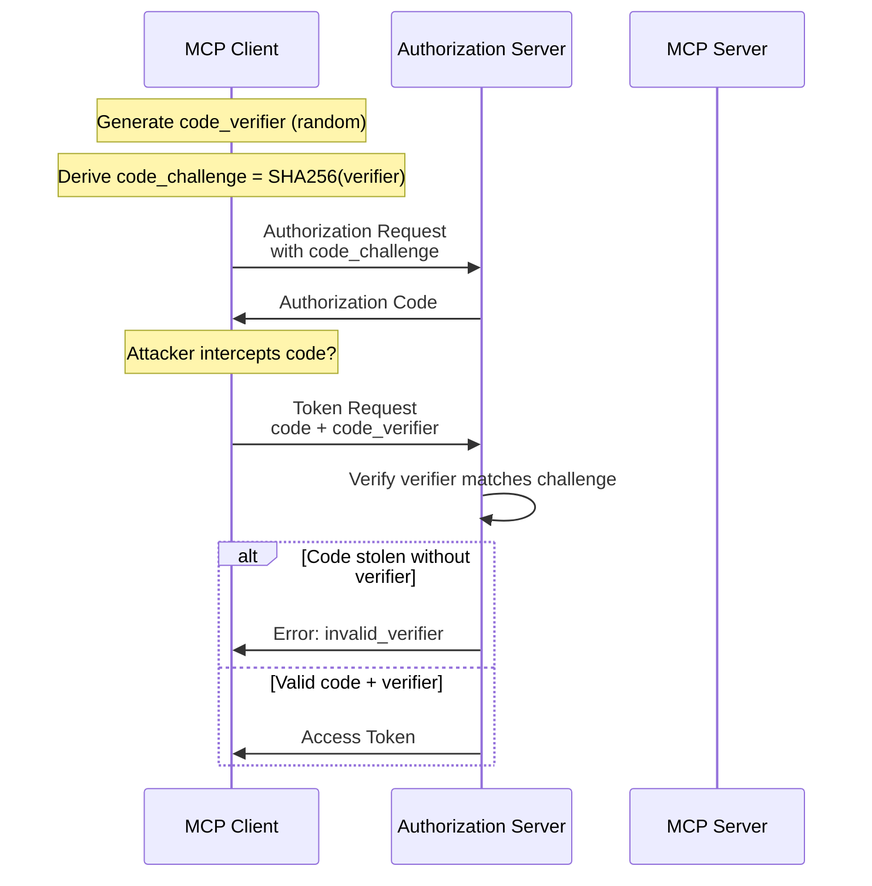
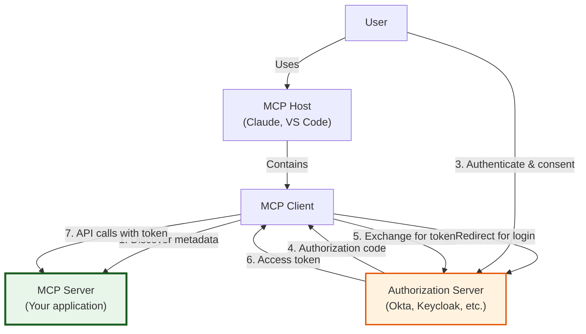
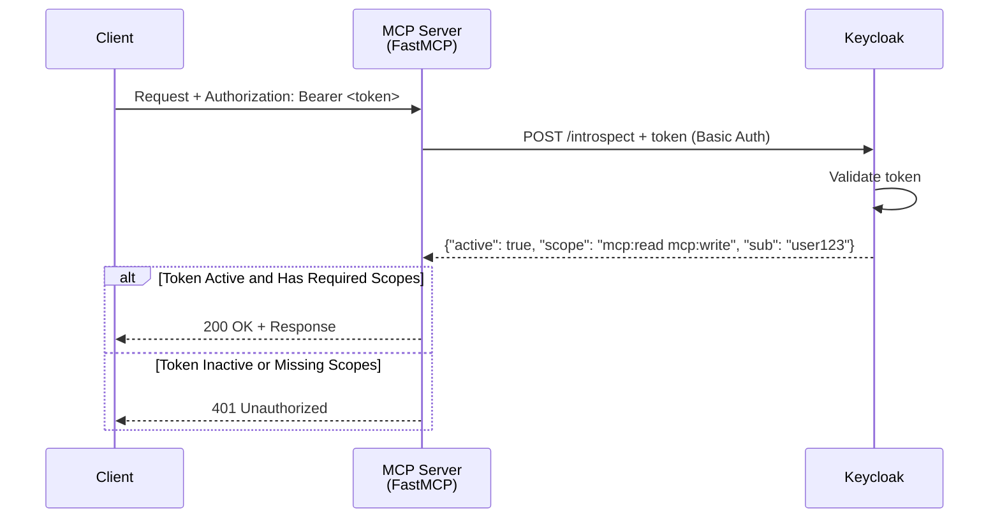
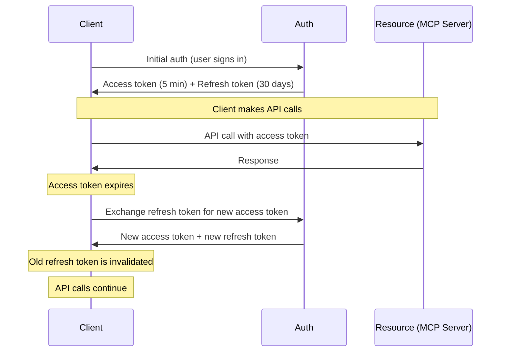
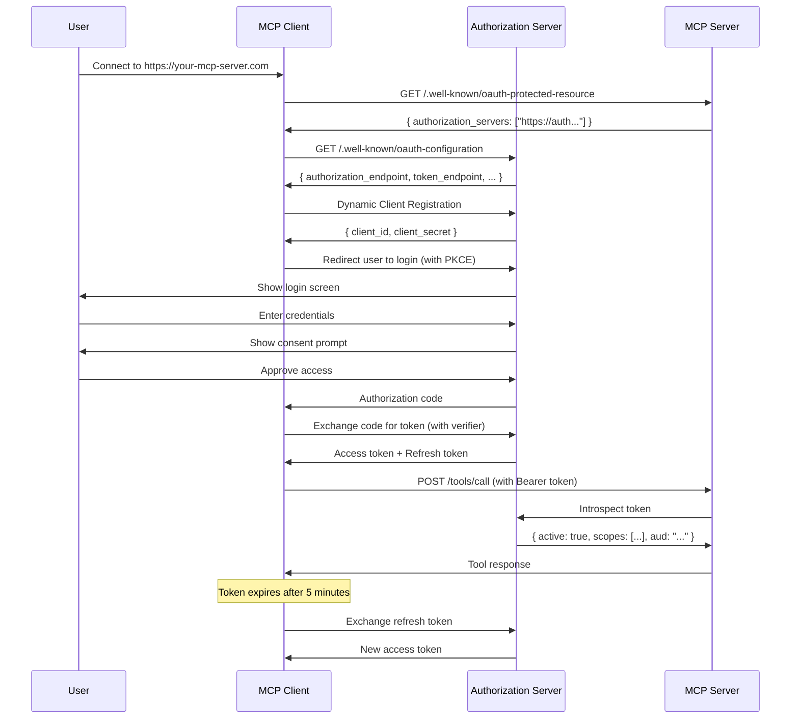
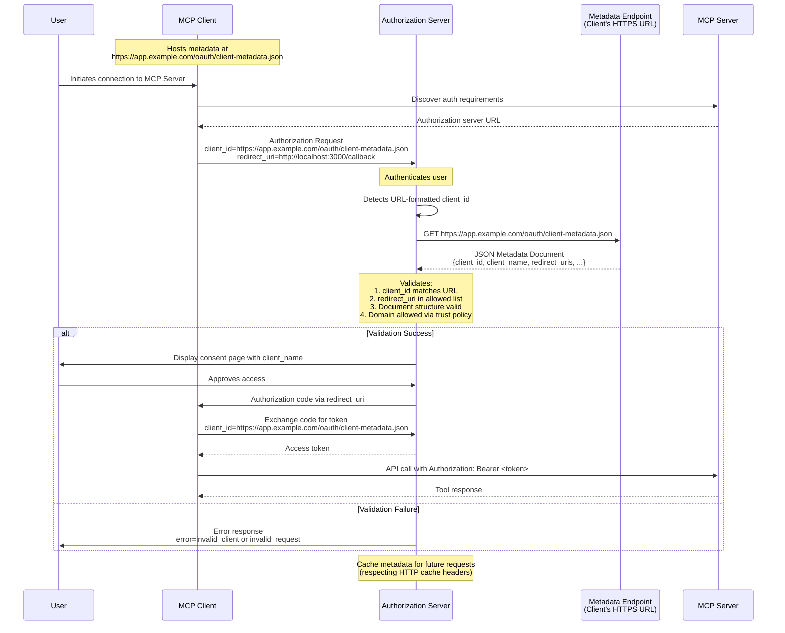

## TL;DR

- **OAuth 2.1 is OAuth 2.0's best practices consolidated into a single specification**—no implicit flow, PKCE required, short-lived tokens
- **MCP uses authorization code flow with PKCE** for public servers and multi-user scenarios where API keys aren't enough
- **Dynamic Client Registration and Protected Resource Metadata** enable any MCP client to discover and connect to your server without manual configuration
- **Scope-based authorization** lets users grant limited permissions (like `todo:read` vs `todo:write`) rather than all-or-nothing access
- **Token refresh and expiration** limit the damage of stolen credentials—access tokens last minutes, refresh tokens can be revoked
- **Use an authorization server** (Okta, Auth0, Keycloak, Scalekit) rather than building your own—OAuth is surprisingly hard to get right

---

## 1. Introduction: When API Keys Aren't Enough

In [Post 5](/posts/mcp-auth-series-basic-auth), we implemented API key authentication for an MCP server. API keys work great for local development and internal tools, but they hit a wall as soon as you need to distinguish between users.

Consider a multi-tenant MCP server that manages customer data:

```
User A (customer_123)  --->  MCP Server  --->  Customer Data
User B (customer_456)  --->                  (separate per customer)
```

With API keys, you have two problems. First, how do you issue a unique key to each user? Second, how do you revoke access when a user leaves without breaking everyone else? You could build a custom key management system, but now you're in the business of storing passwords, handling resets, and dealing with security vulnerabilities you didn't anticipate.

OAuth 2.1 solves this by delegating authentication to an authorization server that you probably already use. When you log into a service with Google, you're using OAuth. The same pattern works for MCP servers.

As Aaron Parecki from Okta explains:

> "OAuth was created to solve a very real problem where people were putting passwords into third-party applications... If you give your password to an app, how do you take that access back? Do you trust that app to access only the things it said it was going to access? Do you trust that application to not do things like change your password?" [1]

A hotel key card is the perfect analogy. When you check in, you show your ID and credit card at the front desk. They give you a key card that opens your room and maybe the gym and pool—but not the rooms of other guests, and not after checkout. That key card is like an OAuth access token: it represents your access to specific resources for a limited time. If you lose it, the front desk can deactivate it immediately. You don't need to change the locks on the entire hotel.

In this post, we'll implement OAuth 2.1 authorization for an MCP server. You'll learn how to use an authorization server, validate tokens, enforce scope-based permissions, and handle token refresh—all without building a full OAuth implementation yourself.

---

## 2. OAuth 2.1: What's Different from OAuth 2.0?

OAuth 2.0 was published in 2012. Since then, the security community has learned painful lessons about what works and what doesn't. OAuth 2.1 consolidates those lessons into a single specification.

### The Key Simplifications

OAuth 2.1 removes dangerous options that OAuth 2.0 allowed:

| OAuth 2.0 Feature | OAuth 2.1 Status | Why? |
|-------------------|------------------|------|
| Implicit flow | **Removed** | Tokens exposed in URL, vulnerable to token leakage |
| Resource Owner Password Credentials | **Removed** | Encourages password anti-patterns |
| PKCE (Proof Key for Code Exchange) | **Required** | Prevents authorization code interception attacks |
| Refresh token rotation | **Required** | Limits damage of token leakage |
| Sender-constrained tokens | **Recommended** | Prevents token theft and replay |

PKCE is the most important addition. Originally designed for mobile apps (where you can't safely store a client secret), PKCE is now recommended for all OAuth clients. It works by having the client generate a random code verifier and a transformed code challenge. The authorization server stores the challenge and verifies the verifier when the client exchanges the authorization code. This prevents attackers from intercepting and replaying the authorization code.



The flow diagram shows why PKCE matters: an attacker who steals the authorization code from the redirect response can't exchange it for a token without the original code verifier. The verifier is never transmitted in the front channel (the browser), so it can't be intercepted.

As Aaron Parecki explains, this consolidation is long overdue:

> "OAuth 2.1 is meant to collapse the last 13 years of specs and set a new baseline for what we're doing with OAuth. If you started with OAuth 2.0 and followed all the best practices—adding PKCE, removing deprecated flows—that is OAuth 2.1." [2]

For MCP servers, this means you can implement "OAuth" without worrying which RFCs to follow. OAuth 2.1 is the baseline.

---

## 3. MCP's OAuth Architecture: Who Does What?

Before writing code, let's clarify the architecture. MCP's OAuth implementation follows the standard pattern but adds MCP-specific discovery mechanisms.



The critical insight is that **your MCP server is the resource server**, not the authorization server. Your job is to validate tokens, not issue them. This separation is intentional:

- **Authorization Server** (Okta, Auth0, Keycloak, Scalekit): Handles user authentication, consent prompts, token issuance, client registration
- **MCP Server** (your code): Validates tokens, enforces scopes, serves tools and resources

This division of labor means you don't need to build a complete OAuth implementation. You just need to validate tokens that your authorization server issued.

### Protected Resource Metadata

MCP adds one innovation: Protected Resource Metadata (RFC 9728). This specification allows an MCP server to point clients to the correct authorization server using a well-known endpoint:

```
GET https://your-mcp-server.com/.well-known/oauth-protected-resource
```

The response contains the authorization server location:

```json
{
  "resource": "https://your-mcp-server.com",
  "authorization_servers": [
    "https://auth.yourcompany.com"
  ]
}
```

The MCP client uses this URL to fetch the authorization server's metadata (RFC 8414), which contains the actual endpoints for authorization, token issuance, and more.

This discovery chain is what enables MCP's "plug and play" experience. A user only needs to provide the MCP server URL. The client discovers everything else automatically.

**Since we published (October 2026):** The 2026-07-28 revision promoted this discovery chain from advice to requirement. RFC 9728 Protected Resource Metadata is now a MUST for MCP servers and for client discovery; clients MUST pass the RFC 8707 `resource` parameter so tokens are audience-bound to your server; and clients MUST validate the `iss` parameter (RFC 9207) on authorization responses—mix-up defense for exactly the chain above. [14] The Keycloak walkthrough below doesn't change, but any production implementation should now treat all three as table stakes.

---

## 4. Implementing OAuth: The Authorization Server

Let's start with the authorization server. You have three options:

| Option | When to Use | Examples |
|--------|-------------|----------|
| **Hosted service** | You want minimal operational overhead | Okta, Auth0, Scalekit |
| **Self-hosted open source** | You need control or compliance | Keycloak, Ory Hydra |
| **Build it yourself** | Air-gapped, highly specialized requirements | Rarely justified |

For this post, we'll use Keycloak as a self-hosted example. The same concepts apply to any OAuth 2.1-compatible authorization server.

### Keycloak Configuration

First, start Keycloak in Docker:

```bash

docker run -d \
  --name keycloak \
  -p 8080:8080 \
  -e KEYCLOAK_ADMIN=admin \
  -e KEYCLOAK_ADMIN_PASSWORD=admin \
  quay.io/keycloak/keycloak:latest \
  start-dev

```

> **Accessing the Admin Console**: You will need to access the Keycloak Admin Console at http://localhost:8080 to get your Client Secret. Log in with the admin credentials (`admin`/`admin`) and navigate to **Clients > your-client > Credentials** to copy the secret.

**Not for production**—this configuration is for testing only. Production Keycloak requires proper SSL, database persistence, and security hardening.

Once running, configure the following:

1. **Create a realm** for your MCP servers (or use `master` for testing)
2. **Create a client** representing your MCP server itself:
   - Client ID: `mcp-server`
   - Client authentication: ON (your server needs to verify tokens)
   - Note the client secret for token introspection
3. **Define scopes** representing your server's capabilities:
   - `mcp:tools` — access to all tools
   - `todo:read` — read todo items
   - `todo:write` — create/modify/delete todos
4. **Configure audience** to match your MCP server URL:
   - This embeds your server's identity into issued tokens
   - Your server validates that tokens were issued for it specifically

The authorization server's `.well-known/openid-configuration` endpoint provides all the URLs clients need:

```bash
curl http://localhost:8080/realms/master/.well-known/openid-configuration
```

This returns the authorization endpoint, token endpoint, supported scopes, and other metadata.

### Dynamic Client Registration

For public MCP servers, you'll also need to enable Dynamic Client Registration (RFC 7591). This allows MCP clients to register themselves automatically without manual configuration.

In Keycloak, navigate to **Clients > Client registration > Trusted hosts** and:
1. Optionally disable "Client URIs Must Match" for development
2. Add your development machine's IP address

**Security note**: For production, restrict the trusted hosts list to specific domains rather than allowing all. Consider implementing rate limiting on the DCR endpoint to prevent abuse.

---

## 4.5. A Note on Client Registration: CIMD vs DCR

Before proceeding to token validation, it's worth noting an ongoing evolution in MCP client registration.

**Update (October 2026): the question is settled.** DCR is now *formally deprecated* in the 2026-07-28 spec revision. The spec defines three registration mechanisms with a priority order: pre-registration → CIMD → DCR, and states plainly that "Dynamic Client Registration is deprecated. New implementations should use Client ID Metadata Documents." [14] CIMD graduated from a community proposal (SEP-991) to adopted spec via PR #2858, and the IETF draft (draft-ietf-oauth-client-id-metadata-document) is active. [15] The FastMCP library has kept pace: its `OAuthProxy` ships CIMD support (`enable_cimd`, on by default). The guidance in this section and the appendix below reflects the pre-deprecation state—read DCR as legacy from here on.

**Dynamic Client Registration (DCR)** is what we just configured in Keycloak. It works, but has limitations: unbounded database growth as every user connection creates a new registration, expiration issues that create open redirect vulnerabilities, and confusing user experiences where the same app appears multiple times with different random client_ids [9].

**Client ID Metadata Documents (CIMD)** is a newer approach specified in [SEP-991](https://github.com/modelcontextprotocol/modelcontextprotocol/issues/991) that uses HTTPS URLs as client identifiers. Instead of storing client metadata, authorization servers fetch it on-demand from the client's domain [8]. The MCP community is moving toward CIMD as the default (SHOULD), with DCR as a fallback (MAY).

**The catch**: Most current authorization servers, including stock Keycloak, don't support CIMD out of the box. CIMD requires authorization server extensions or custom implementations that can detect URL-formatted client_ids and fetch metadata from arbitrary domains.

**For this tutorial**: We'll use DCR with Keycloak, which is widely supported and works today. If your authorization server supports CIMD, or if you're building a custom solution, see the "Future Look" appendix at the end of this post for CIMD details.

The architecture and token validation code in the following sections work the same way regardless of whether clients register via DCR or CIMD—your MCP server validates tokens the same way either way.

---

## 5. Implementing OAuth: Token Validation on Your MCP Server (Resource Server)

Now let's implement the MCP server side. In OAuth terminology, your MCP server acts as the **Resource Server**—it validates tokens issued by the Authorization Server and protects your tools and resources.

We need to:

1. Host the Protected Resource Metadata endpoint
2. Validate incoming access tokens
3. Enforce scope-based permissions

FastMCP provides a built-in `IntrospectionTokenVerifier` that implements RFC 7662 Token Introspection, validating opaque tokens by calling an authorization server's introspection endpoint [11]. This works with Keycloak, Auth0, Okta, and any OAuth 2.1-compliant authorization server.

Here's a complete Python implementation using FastMCP with Keycloak:

```python

import os
from fastmcp import FastMCP
from fastmcp.server.auth.providers.introspection import IntrospectionTokenVerifier
from mcp.server.auth.settings import AuthSettings
from pydantic import AnyHttpUrl


# Configuration from environment
KEYCLOAK_URL = os.getenv("KEYCLOAK_URL", "http://localhost:8080")
REALM = os.getenv("KEYCLOAK_REALM", "master")
MCP_SERVER_URL = os.getenv("MCP_SERVER_URL", "http://localhost:8000")

# Build the introspection endpoint URL
introspection_url = (
    f"{KEYCLOAK_URL}/realms/{REALM}"
    "/protocol/openid-connect/token/introspect"
)

# Create the introspection verifier for Keycloak
verifier = IntrospectionTokenVerifier(
    # Keycloak's token introspection endpoint (RFC 7662)
    introspection_url=introspection_url,
    # MCP server's credentials for authenticating to Keycloak
    client_id="mcp-server",
    client_secret=os.getenv("KEYCLOAK_CLIENT_SECRET"),
    # Required OAuth scopes for accessing this server
    required_scopes=["mcp:read", "mcp:write"],
)

# Create FastMCP server with OAuth authentication
mcp = FastMCP(
    "TodoServer",
    # The verifier enforces authentication on all requests
    token_verifier=verifier,
    # Enable RFC 9728 Protected Resource Metadata
    auth=AuthSettings(
        issuer_url=AnyHttpUrl(f"{KEYCLOAK_URL}/realms/{REALM}"),
        resource_server_url=AnyHttpUrl(MCP_SERVER_URL),
        required_scopes=["mcp:read", "mcp:write"],
    ),
)


@mcp.tool()
async def list_todos() -> dict:
    """
    List all todo items.
    Requires 'mcp:read' scope.
    Unauthenticated requests never reach this code.
    """
    return {
        "todos": [
            {"id": 1, "title": "Learn MCP OAuth", "done": False},
            {"id": 2, "title": "Deploy to production", "done": False},
        ]
    }


@mcp.tool()
async def create_todo(title: str, description: str = "") -> dict:
    """
    Create a new todo item.
    Requires 'mcp:write' scope.
    """
    return {
        "id": 3,
        "title": title,
        "description": description,
        "done": False,
        "status": "created",
    }


@mcp.tool()
async def delete_todo(todo_id: int) -> dict:
    """
    Delete a todo item by ID.
    Requires 'mcp:write' scope.
    """
    return {"todo_id": todo_id, "status": "deleted"}


if __name__ == "__main__":
    # Run with SSE transport for HTTP-based OAuth
    mcp.run(transport="sse")

```

### How IntrospectionTokenVerifier Works

The `IntrospectionTokenVerifier` handles the full RFC 7662 flow [11]:

1. **Extracts the bearer token** from the incoming `Authorization` header
2. **Authenticates to Keycloak** using HTTP Basic Auth with the provided `client_id` and `client_secret`
3. **Sends the token** to Keycloak's introspection endpoint via POST
4. **Validates the response**: checks that `active` is true, extracts scopes and user identity
5. **Enforces required_scopes**: rejects tokens missing any required scope with HTTP 403
6. **Returns an AccessToken** if valid, or `None` if invalid (causing FastMCP to reject with HTTP 401)

As the FastMCP documentation explains: "This verifier validates opaque tokens by calling an OAuth 2.0 token introspection endpoint... The verifier authenticates to the introspection endpoint using HTTP Basic Auth with the provided client_id and client_secret, as specified in RFC 7662" [11].

### Visualizing the Introspection Flow



### Protected Resource Metadata

The `AuthSettings` configuration enables the `.well-known/oauth-protected-resource` endpoint defined in RFC 9728. Clients can discover your server's authentication requirements by querying:

```bash
GET http://localhost:8000/.well-known/oauth-protected-resource
```

This returns metadata including the authorization server URL, required scopes, and supported token types—allowing MCP clients to automatically configure authentication [5].

### Why Introspection Over JWT?

Introspection requires a network call for each token validation, which adds latency. But it provides advantages:

- **Instant revocation**: If a token is revoked at the authorization server, the next introspection call immediately detects it
- **Opaque token support**: Works with authorization servers that don't issue JWTs
- **Centralized validation**: The authorization server is the single source of truth for token status

JWT verification is faster (no network call) but cannot detect revocation until the token naturally expires.

### Keycloak Setup Checklist

For this to work with Keycloak:

1. **Create a confidential client** in Keycloak with `Service Accounts Enabled`
2. **Grant the client** `token-exchange` and `introspect` client scopes
3. **Generate a client secret** and store it in the `KEYCLOAK_CLIENT_SECRET` environment variable
4. **Configure scopes** like `mcp:read` and `mcp:write` in Keycloak's client scopes
5. **Point the introspection_url** to your realm's introspection endpoint

---

## 6. Scope-Based Authorization

Scopes are OAuth's authorization mechanism. They represent what actions a client can perform on behalf of a user. Unlike all-or-nothing API keys, scopes allow users to grant limited access.

### Defining Scopes

Good scope design follows the principle of least privilege. Group related actions and separate read from write:

```
mcp:tools        # All tools (broad, for testing)
todo:read        # Read todos
todo:write       # Create/modify/delete todos
calendar:read    # Read calendar events
calendar:write   # Create/modify events
```

The colon separator is a convention, not a requirement. Use whatever makes sense for your domain.

### Enforcing Scopes Per Tool

FastMCP's `IntrospectionTokenVerifier` handles scope validation at the middleware level. The `required_scopes` parameter ensures all tokens have at least the specified scopes. For per-tool scope checking, you have two options:

**Option 1: Global scopes at the verifier level**

Set `required_scopes` in the verifier to enforce the same scopes for all tools:

```python

verifier = IntrospectionTokenVerifier(
    introspection_url=introspection_url,
    client_id="mcp-server",
    client_secret=os.getenv("KEYCLOAK_CLIENT_SECRET"),
    # All tools require these scopes
    required_scopes=["mcp:read", "mcp:write"],
)

```

**Option 2: Per-tool scope checking with decorators**

For finer-grained control, check scopes within individual tools using the auth context. FastMCP makes token metadata available in the request context for authorized requests:

```python

from functools import wraps
from fastmcp import FastMCP

def require_scope(*required_scopes: str):
    """
    Decorator that checks if the current request has the required scopes.
    Raises PermissionError if scopes are missing.
    """
    def decorator(func):
        @wraps(func)
        async def wrapper(*args, **kwargs):
            # FastMCP injects auth context for authorized requests
            # The exact access pattern depends on FastMCP version
            # Check your version's documentation for accessing token metadata
            token_scopes = []  # Would be populated from request context
            missing = [s for s in required_scopes if s not in token_scopes]
            if missing:
                raise PermissionError(
                    f"Insufficient scope. Required: {', '.join(missing)}"
                )
            return await func(*args, **kwargs)
        return wrapper
    return decorator


# Usage with a tool
@mcp.tool()
@require_scope("mcp:write")
async def delete_todo(todo_id: int) -> dict:
    """
    Delete a todo item by ID.
    Requires 'mcp:write' scope.
    """
    # If the verifier's required_scopes doesn't include mcp:write,
    # unscoped requests would be rejected before reaching here
    return {"todo_id": todo_id, "status": "deleted"}

```

In practice, the global `required_scopes` approach in `IntrospectionTokenVerifier` is simpler and more secure. FastMCP rejects unauthorized requests before they reach your tool code, so you don't need to add manual checks in every function.

### User Experience: The Consent Prompt

When a user first connects an MCP client to your server, they see a consent prompt listing the requested scopes:

```
Todo MCP Server is requesting permission to:

  Read your todo items (todo:read)
  Create and modify todos (todo:write)

This client was developed by Example Corp.
[Allow] [Cancel]
```

This transparency is a key benefit of OAuth. Users understand what they're granting, and authorization servers provide audit logs of all granted permissions.

---

## 7. Token Refresh and Expiration

Access tokens should be short-lived (5-60 minutes). If stolen, they expire quickly, limiting damage. But requiring users to re-authenticate every hour is terrible UX.

The solution is refresh tokens: long-lived credentials that can be exchanged for new access tokens without user interaction.

### Refresh Token Flow



### Implementing Token Refresh

On the client side, most OAuth libraries handle refresh automatically. When an API call returns 401 Unauthorized, the library exchanges the refresh token and retries the request.

On the server side, ensure your tokens include proper expiration:

```json
{
  "exp": 1735689600,
  "iat": 1735689000,
  "client_id": "mcp-client-abc",
  "aud": "https://your-mcp-server.com",
  "scope": "todo:read todo:write"
}
```

The `exp` claim is the Unix timestamp when the token expires. Your token validation should check this, although introspection endpoints typically handle it automatically.

### Revocation: The Ultimate Safety Valve

One advantage of OAuth over API keys is centralized revocation. When a user's access is revoked (they leave the organization, their session is compromised, etc.), the authorization server marks all their tokens as invalid. Future introspection checks return `active: false`, and access is immediately denied.

As Aaron Parecki notes, this infrastructure is easy to overlook:

> "Having the ability to revoke access on demand is important. Make sure you have the infrastructure internally so that if you need to terminate a particular access token or authorization chain, you have the audit trail internally to do that." [2]

Ensure your authorization server provides a revocation API and that your audit logging tracks which grants were issued to which users.

---

## 8. Common Pitfalls and How to Avoid Them

OAuth 2.1 simplifies many aspects of OAuth, but implementation still has pitfalls.

### Don't Implement Token Validation Yourself

Use libraries from your authorization server or well-maintained open-source projects. JWT validation requires signature verification, claim checking, and proper error handling—all easy to get wrong.

### Don't Use Long-Lived Access Tokens

Access tokens should expire in minutes, not days. Refresh tokens handle long-term access; access tokens are for immediate API calls.

### Don't Forward Tokens to Downstream APIs

If your MCP server calls other APIs (GitHub, Google, etc.), obtain separate tokens for those services. Don't forward the user's MCP access token. This prevents token leakage and limits the blast radius if a token is compromised.

As Wils Dawson from Arcade warns:

> "It's very tempting to say, 'Let's just use the credentials that the client has and pipe them through.' There are very subtle security vulnerabilities and traps that occur when you do that. It's very important that those two stay separate." [3]

### Don't Log Tokens or Authorization Codes

Never include tokens, codes, or secrets in logs. If you need to log authentication events, log opaque identifiers or claims—but never the credentials themselves.

### Don't Ignore Audience Validation

Always check that tokens were issued for your specific server. Without audience validation, a token intended for one service could be used against another.

### Don't Use Implicit Flow or Resource Owner Password

OAuth 2.1 removes these for good reason. Implicit flow exposes tokens in URLs. Resource Owner Password encourages giving your password to third parties. Use authorization code flow with PKCE.

---

## 9. Putting It All Together

Here's the complete OAuth flow from user connection to API call:



This flow gives you:

- **User authentication** handled by a dedicated authorization server
- **User consent** with transparent scope disclosure
- **Token validation** without storing user credentials
- **Token refresh** without requiring user interaction
- **Centralized revocation** if access is compromised

---

## Key Takeaways

- **OAuth 2.1 consolidates 13 years of OAuth hard-won lessons** into a single specification. PKCE is required, implicit flow is removed, and refresh token rotation is mandatory.

- **Your MCP server is the resource server, not the authorization server**. Validate tokens issued by a trusted authorization server rather than building your own OAuth implementation.

- **Protected Resource Metadata enables client discovery**. Host the `.well-known/oauth-protected-resource` endpoint so clients can find your authorization server automatically.

- **Scope-based authorization implements least privilege**. Define fine-grained scopes (`todo:read`, `todo:write`) and enforce them per-tool rather than granting all-or-nothing access.

- **Short-lived access tokens plus refresh tokens balance security and UX**. Access tokens expire in minutes; refresh tokens handle long-term access and can be revoked.

- **Don't forward client tokens to downstream APIs**. Your MCP server should obtain its own tokens for any external services it calls.

- **Use an authorization server, don't build your own**. Okta, Auth0, Keycloak, Scalekit, and other services handle credential storage, security updates, and compliance.

---

## References

[1] Aaron Parecki. "[Intro to OAuth for MCP Servers](https://www.youtube.com/watch?v=mYKMwZcGynw)." MCP Developers Summit 2025. May 23, 2025.

[2] Aaron Parecki, Darren McAdams, Dan Delmarski. "[MCP Gets OAuth: Understanding the New Authorization Specification](https://www.youtube.com/watch?v=EXxIeOfJsqA)." Microsoft Developer. July 30, 2025.

[3] Wils Dawson. "[MCP Authentication: The Confusing Parts Explained](https://arcade.dev/blog/mcp-authentication/)." Arcade. July 8, 2025.

[4] Model Context Protocol. "[Authorization](https://modelcontextprotocol.io/docs/tutorials/security/authorization)." Official MCP Documentation.

[5] RFC 9728. "[OAuth 2.0 Protected Resource Metadata](https://datatracker.ietf.org/doc/html/rfc9728)." IETF.

[6] RFC 8707. "[Resource Indicators for OAuth 2.0](https://datatracker.ietf.org/doc/html/rfc8707)." IETF.

[7] RFC 7636. "[PKCE: Proof Key for Code Exchange](https://datatracker.ietf.org/doc/html/rfc7636)." IETF.

[8] Paul Carleton, Aaron Parecki. "[SEP-991: OAuth Client ID Metadata Documents for MCP](https://github.com/modelcontextprotocol/modelcontextprotocol/issues/991)." Model Context Protocol. July 17, 2025.

[9] Will Johnson. "[Client ID Metadata Documents Are the Future of MCP Client Registration](https://auth0.com/blog/cimd-vs-dcr-mcp-registration/)." Auth0 Blog. November 24, 2025.

[10] Paul Carleton. "[Why is MCP Auth Hard and What Are We Planning to Do About It](https://www.youtube.com/watch?v=wvtGlur2SdI)." MCP Developers Summit EU 2025. November 18, 2025.

[11] FastMCP Documentation. "[introspection](https://gofastmcp.com/python-sdk/fastmcp-server-auth-providers-introspection)." API Reference. Accessed December 2025.

[12] RFC 7662. "[OAuth 2.0 Token Introspection](https://datatracker.ietf.org/doc/html/rfc7662)." IETF. October 2015.

[13] Keycloak Documentation. "[Token Introspection Endpoint](https://www.keycloak.org/docs/latest/securing_apps/#_token-introspection)." Red Hat.

[14] Model Context Protocol. "[Client Registration](https://modelcontextprotocol.io/specification/2026-07-28/basic/authorization/client-registration)." Official MCP Specification, 2026-07-28 revision. Accessed October 13, 2026. Defines the pre-registration → CIMD → DCR priority and the formal deprecation of DCR.

[15] IETF. "[OAuth Client ID Metadata Documents](https://datatracker.ietf.org/doc/draft-ietf-oauth-client-id-metadata-document)" (draft-ietf-oauth-client-id-metadata-document-02, active). Accessed October 13, 2026.

---

## Future Look: Client ID Metadata Documents (CIMD)



Dynamic Client Registration works, but the MCP community has identified significant limitations. A newer approach called **Client ID Metadata Documents (CIMD)** is emerging as the preferred solution for open ecosystems [1].

### What is CIMD?

**CIMD** (Client ID Metadata Documents) allows OAuth clients to use HTTPS URLs as their client identifiers. Instead of a random string like `client_abc123`, the client_id itself is a URL that points to a JSON document containing the client's metadata [8].

Think of this like showing a driver's license at a bar. The bouncer (authorization server) doesn't need to file away your information in a cabinet—they just verify that your license is valid and belongs to you. CIMD works the same way: the client's URL serves as both identifier and verification mechanism [9].

**The core innovation**: Instead of the server storing client metadata, the client hosts it at their own domain. The authorization server fetches this metadata on-demand when needed [8].

A CIMD is a simple JSON file hosted at the client's domain:

```json
{
  "client_id": "https://app.example.com/oauth/client-metadata.json",
  "client_name": "Example MCP Client",
  "client_uri": "https://app.example.com",
  "logo_uri": "https://app.example.com/logo.png",
  "redirect_uris": [
    "http://127.0.0.1:3000/callback",
    "http://localhost:3000/callback"
  ],
  "grant_types": ["authorization_code"],
  "response_types": ["code"],
  "token_endpoint_auth_method": "none"
}
```

When a client needs to connect to an MCP server, it sends this URL as its `client_id`. The server fetches the document, validates it, and uses the metadata to complete the OAuth flow [1].

This approach is specified in [SEP-991](https://github.com/modelcontextprotocol/modelcontextprotocol/issues/991) and is based on an IETF draft specification. The proposal elevates CIMD to a **SHOULD** requirement in MCP, while downgrading DCR to **MAY** [1].

### Three Problems CIMD Solves

Dynamic Client Registration was designed for a world where apps register once and connect frequently. MCP reverses this: clients connect to many servers they've never seen before, often triggering DCR on every connection. This mismatch creates three critical problems [9].

**Problem 1: Unbounded Database Growth**

Think of DCR like an office reception desk. Every visitor fills out a form, and the receptionist files it away. In a traditional OAuth scenario, the same app returns repeatedly—one filing cabinet entry per app. But in MCP's open ecosystem, every user connection might trigger a new DCR request. If 10,000 users connect Claude Desktop to your server, you now have 10,000 client registrations—all for the same application.

With CIMD, there's no filing cabinet. The URL itself is the identifier, stable and permanent. The authorization server can optionally cache metadata for performance (up to 24 hours recommended), but there's no persistent database that grows without bound [9].

**Problem 2: Expiration and Open Redirects**

DCR entries don't live forever. Authorization servers purge stale registrations to prevent database bloat. But when a client_id is purged, the server loses the record of its allowed redirect_uris. If that client tries to authorize again, the server can't safely redirect even with an error message—creating an open redirect vulnerability where attackers can manipulate URLs [10].

CIMD sidesteps this entirely. The metadata URL doesn't expire, and redirect URIs are always fetched fresh from the source. There's no expiration to manage, no purging logic, and no open redirect risk [8].

**Problem 3: Cluttered Authorized Clients Screen**

When users review their connected apps in their authorization server, DCR creates a confusing experience. The same app appears multiple times with different random client_ids—`abc123xyz`, `def456uvw`, `ghi789rst`—all representing "Claude Desktop." Users can't tell which is which, leading to either blanket revocation or learned helplessness [9].

With CIMD, the client_id is a meaningful URL: `https://claude.ai/.well-known/oauth-client-metadata`. Users see one recognizable entry per app, making it clear what they've authorized and easier to manage [9].

### How CIMD Works

The CIMD flow is elegant in its simplicity. Instead of storing client metadata, the authorization server fetches it on-demand [8].

1. **Client hosts metadata at their domain**: The MCP client developer deploys a static JSON file at a predictable HTTPS URL. This file contains the client's metadata: name, logo, allowed redirect URIs, and authentication method [8].

2. **Client sends URL as client_id**: During the OAuth authorization request, instead of a random string like `client_abc123`, the client sends its metadata URL as the client_id parameter [8].

3. **Server fetches and validates**: The authorization server detects the URL-formatted client_id and performs an HTTP GET request to retrieve the metadata document. It then validates that the client_id inside the JSON matches the URL it was fetched from, checks that the requested redirect_uri is in the allowed list, and verifies the document structure is valid [8].

4. **Caching for performance**: Once validated, the server caches the metadata respecting HTTP cache headers (max 24 hours recommended). Subsequent authorization requests from the same client use the cached metadata, avoiding repeated fetches [8].

The critical security property is redirect_uri attestation. Because the metadata document is served over HTTPS from the client's domain, the authorization server can trust that the redirect_uris list is controlled by the legitimate client owner—not an attacker supplying arbitrary URLs during registration [9].

### CIMD Flow Diagram

Here's the complete CIMD authorization flow, showing how metadata fetching integrates with the standard OAuth authorization code flow:



The diagram shows the key moment: the authorization server fetches metadata directly from the client's domain, validating that the redirect_uri the attacker might try to slip in won't match the list in the legitimate metadata file [8].

### When to Use CIMD vs DCR vs Pre-Registration

MCP's SEP-991 proposal establishes a clear hierarchy: CIMD as the default (SHOULD), DCR as a fallback (MAY), and pre-registration for enterprise scenarios [8].

**CIMD: Default for Open Ecosystems**

Use CIMD when building a public MCP server that needs to accept connections from any client. This is the common case for community servers, developer tools, and SaaS products. CIMD provides the best balance of security, scalability, and user experience without requiring prior coordination between client and server developers [8].

**DCR: Fallback for Legacy Clients**

Keep DCR enabled as a fallback for clients that can't host metadata documents. This might include legacy applications, internal tools without public domains, or development scenarios. However, be aware of the scaling and security limitations, and consider rate-limiting DCR endpoints to prevent abuse [9].

**Pre-Registration: Enterprise Scenarios**

For enterprise deployments with known clients, traditional pre-registration remains optimal. When both client and server developers can coordinate upfront, pre-registration provides the strongest security boundary: the authorization server issues credentials directly to known parties after vetting. This is the right choice for internal enterprise MCP servers, B2B integrations, and any scenario where a pre-existing relationship exists [9].

The key insight is that MCP supports all three approaches simultaneously. Your authorization server can check for URL-formatted client_ids (CIMD), fall back to DCR for opaque client_ids, and respect pre-registered credentials—all in the same implementation [8].

**Closing note (October 2026):** the hierarchy above is now spec, not proposal—pre-registration first, CIMD second, DCR deprecated last [14]. If your authorization server can't serve CIMD yet, you're not stuck: FastMCP's `OAuthProxy` handles CIMD clients out of the box (`enable_cimd` is enabled by default), which covers the common "stock Keycloak + remote MCP client" gap this appendix described. Stock Keycloak's own CIMD story remains a gap; check your server's current documentation before designing around it.


